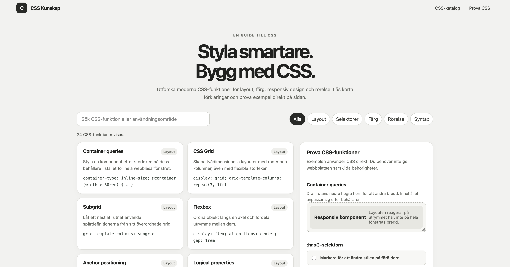
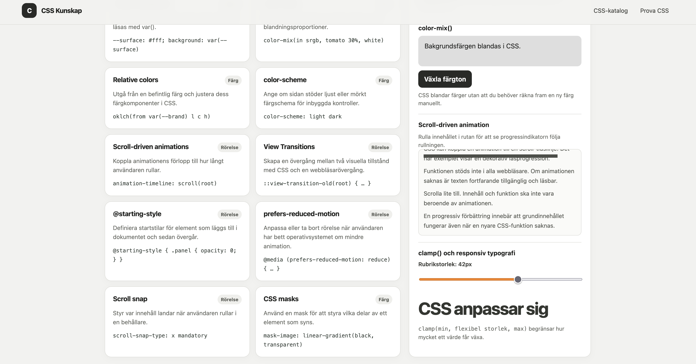
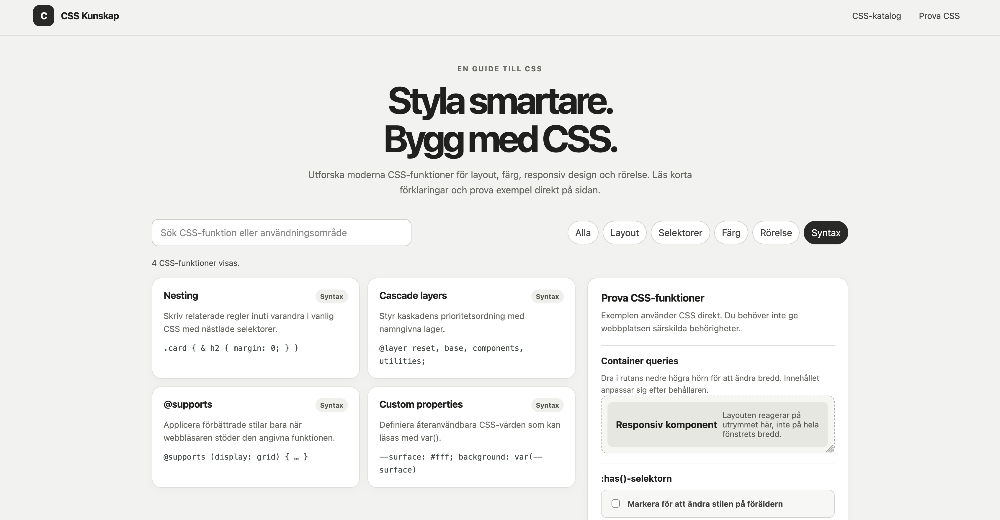

# CSSAPI
Olika CSS funktioner som visar stöd i olika webbläsare m.m. med filter. Utöka då syftet är att använda i internutbildning alternativt vid test av anställning av ny personal.

Utöka i syfte för anpassning för er verksamhet alternativt vad ni behöver testa eller kontrollera nya kandidater med.

